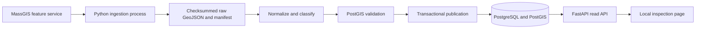

# Engineering boundary for the first local slice

The database is Docker-managed; API and ingestion are local WSL Python processes. A database session advisory lock prevents overlapping Hudson imports. Source pages are written before import; normalized rows and publication activation commit together. Transaction rollback leaves the existing active publication untouched. No public deployment is configured.

## Source-to-model mapping

| Source field | Initial meaning | Limitation |
| --- | --- | --- |
| OBJECTID | Unique row within a snapshot/publication | Not an identity across releases |
| TOWN_ID | Municipal scope; Hudson = 141 | Other towns deliberately disabled |
| LOC_ID | Source parcel identifier | Multiple feature rows can share it; splits/merges unresolved |
| PROP_ID | Source assessment identifier | Not assumed one-to-one with a geometry |
| MAP_PAR_ID | Original parcel map reference | Retained in raw attributes |
| OWNER1 | Reported owner name | Not a verified person, company, or decision-maker |
| OWN_ADDR / OWN_CITY / OWN_STATE / OWN_ZIP | Reported mailing address | Normalization does not verify deliverability |
| SITE_ADDR | Reported site address | Missing values flagged |
| USE_DESC / USE_CODE | Classification evidence | Initial rules are conservative and versioned |
| UNITS | Source units when greater than zero | Zero treated as unknown |
| TOTAL_VAL / LAND_VAL / BLDG_VAL | Original assessed values | Retained but not aggregated across joined rows |
| FY | Assessment fiscal year | Distinct from acquisition date |
| NO_MATCH | Provider assessor join indicator | Y flagged as missing source match |

## Next model evolution

Keep source features as evidence, then introduce separately reconciled parcels, assessments, physical sites, parties, and temporal property-party roles. Do not turn source name strings into canonical parties automatically. Human-reviewed links must survive publication refreshes, with explicit reconciliation for changed identifiers.

Quality issue counts and segment counts currently use source feature grain. Search additionally exposes distinct parcel and assessment identifiers. These are not yet deduplicated marketable-property or contact counts.

## Deliberately not implemented yet

Durable job queue/leases, admin write API, map tiles, authentication, canonical party resolution, enriched contacts, fuzzy matching, saved prospect lists, GoHighLevel export, second-town support, production gateway and backup automation. These are sequenced after the source and data-grain findings from this local pilot.
