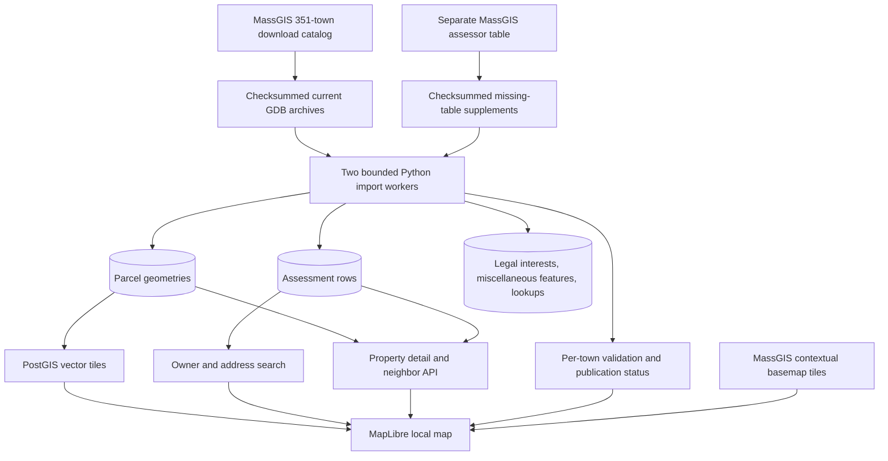

# Massachusetts local property map

## Source research

The [Massachusetts Interactive Property Map documentation](https://www.mass.gov/info-details/massachusetts-interactive-property-map) describes a statewide parcel map, property popups, address search, municipal downloads, source-currency dashboard and additional tools. MassGIS separates cached display geometry from popup feature records. The page's direct HTML endpoint returned HTTP 403 in this environment; its indexed official documentation and official ArcGIS map configuration were accessible.

Sources used:

- Official map configuration: https://www.arcgis.com/sharing/rest/content/items/a2dc6f81ce7d4846a05e9895810a7a48/data?f=json
- Municipal download catalog: https://arcgisserver.digital.mass.gov/arcgisserver/rest/services/AGOL/L3_FTP_Download/MapServer/0
- Parcel documentation: https://www.mass.gov/info-details/massgis-data-property-tax-parcels
- Separate assessor table, used only where a town package omits Assess: https://arcgisserver.digital.mass.gov/arcgisserver/rest/services/AGOL/MassachusettsPropertyTaxParcels/FeatureServer/4
- Basemap: https://tiles.arcgis.com/tiles/hGdibHYSPO59RG1h/arcgis/rest/services/MassGISBasemap/MapServer

The complete latest-package catalog has 351 municipalities. Downloads total 1,013,469,665 bytes before assessment supplements. This is the currently offered archive for every town, not an archive of all historical vintages and not live municipal ground truth.

## Engineering flow

The root URL is the statewide map. `/hudson` preserves the original hosted-feature-layer diagnostic pilot. The data stores are separate, so the original published Hudson snapshot and research notes are untouched.

The browser pins a dataset UUID for all town, tile, search and detail requests. While an initial dataset is loading, the coverage label reports actual completed towns and tiles bypass the in-process cache. Completed datasets use a bounded 128-entry tile cache. A new complete dataset would be selected by the catalog; older UUIDs remain queryable. There is no production authentication or deployment in this local-only slice.

## Data meaning

- `map_datasets`: source manifest, processing fingerprint and statewide readiness.
- `map_towns`: archive provenance, municipal catalog fiscal year, counts, layer inventory, use-code descriptions, boundaries and readiness.
- `map_parcels`: original municipal parcel feature grain, source FID, LOC_ID, map parcel ID, derived segment, number of linked assessments and usable geometry.
- `map_assessments`: original assessor row grain, source FID, property ID, LOC_ID, normalized contact-research fields and untouched source attributes.
- `map_supplementary`: all remaining source layers and lookup rows. Supplemental invalid geometry is absent from its display column but remains preserved in the original GDB archive.

Parcel/assessment links use municipality plus LOC_ID within the same dataset. FIDs are source-snapshot identifiers, not permanent real-world identities. Multiple assessments on one parcel are displayed separately. No property valuation sums are calculated across parcel joins.

Use descriptions come from each town's UC_LUT. Classification is intentionally conservative; unknowns remain visible. A parcel with conflicting linked assessment segments is labeled `multiple_uses`, which does not assert a legal mixed-use designation. Search segment filters use the same parcel-level classification as the map.

Source curves are linearized by GDAL at a 1-degree angular step solely for our spatial/display representation. Invalid/empty geometries are quarantined without automated repair. The archives are the full-fidelity source. Candidate neighbors use intersection or distance <= 0.1 meters in Massachusetts EPSG:26986 and are explicitly not a legal abutters list.

## Supporting records view

Choose **Record view → Supporting records only** to isolate supporting source records. The map displays usable spatial features; the searchable results also include non-spatial lookup entries. Select a record to inspect its original source fields. Town filters apply to both the map and list. Switch back to **Property parcels** to restore parcel and assessment browsing.

## API

- `GET /api/v1/map/catalog`: dataset selection and municipal progress/counts.
- `GET /api/v1/map/{dataset}/towns.geojson`: municipal overview geometry.
- `GET /api/v1/map/{dataset}/tiles/{z}/{x}/{y}.mvt`: bounded, filtered local vector tiles.
- `GET /api/v1/map/{dataset}/supporting`: paginated supporting records, with town and source-field search.
- `GET /api/v1/map/{dataset}/supporting/{town_id}/{layer}/{source_fid}`: supporting source fields and optional geometry.
- `GET /api/v1/map/{dataset}/search`: paginated assessor records; address/owner/town/parcel-segment filters.
- `GET /api/v1/map/{dataset}/parcels/{id}`: parcel evidence and up to 100 linked assessment records per page.
- `GET /api/v1/map/{dataset}/parcels/{id}/abutters`: bounded candidate neighboring parcels.

Tiles accept `records=parcels` (default) or `records=supporting`. Parcel tiles begin at zoom 13 and reject oversized requests rather than silently dropping records. Search/detail IDs and filters are parameterized. Search and tiles have database statement timeouts. Trigram indexes support address/owner searches; GiST supports map queries.

## Limits

This builds our property-intelligence map, not a pixel-for-pixel clone of every state-map tool. Printing, measurement, imagery switching, live geocoding, legal abutters exports, contact enrichment, saved campaign lists and GoHighLevel synchronization are not implemented. Browser searches use the downloaded source addresses and owners, not an external geocoder. Basemap imagery/roads are streamed and are not included in the locally downloaded parcel dataset.
